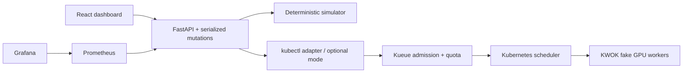

# Architecture and operations

Simulator and Kubernetes modes are separate sources of truth. KWOK stages and node templates are adapted from the upstream KWOK project; see infra/NOTICE. The dashboard polls every five seconds. User actions refresh immediately. Simulator mutations run under an RLock so concurrent requests cannot oversubscribe the fleet. No external GPU metrics or random utilization values are invented. State is intentionally ephemeral.

The Kubernetes adapter explicitly targets the disposable lab context, and only submits to team-a or team-b. Kubernetes performs admission/placement asynchronously. Admission and actual pod placement differ; a workload may hold quota while pods await healthy capacity. The adapter reports scheduler/controller condition text rather than substituting simulator decisions.

## Troubleshooting

**Job waiting:** inspect its explanation, GPU type, healthy capacity, competing priorities, and victim preemptibility. H100 never fits an A100-only fleet. Whole-job reclaim may be impossible without cutting another team's nominal share.

**Node failed:** inspect the interruption event and job allocations. Simulator nominal quotas remain at 8 per team even when capacity drops to 12; nominal quota is not a promise that broken hardware remains available.

**VM download times out:** use the official Podman machine-os release image with a resumable `curl -C -` download, verify its release SHA-256, and pass the local `.raw.zst` file with `podman machine init --image`. The tested arm64 AppleHV image is v6.1.4-1. A failed first boot can leave account locks: recreate only an empty disposable VM, never one containing workloads you need.

**Kubernetes startup fails:** confirm Podman VM is running, inspect `kind get clusters`, and use `kubectl --context kind-gpu-fleet -n kube-system logs deployment/kwok-controller`. Inspect Kueue logs in `kueue-system`, CRD availability, and controller rollout status. Setup uses pinned older versions for a stable manifest API; upgrade both dependencies and templates together.

**Kubernetes job not running:** inspect `kubectl --context kind-gpu-fleet -n team-a get jobs,pods,workloads` and `describe workload`. Check queue admission conditions separately from pod scheduling events. Ensure nodes advertise `nvidia.com/gpu`, resource flavor labels match, and fake-node tolerations exist.

**Monitoring target down:** check host reachability from the Podman VM, `/metrics`, and the selected port. Prometheus runs on wall clock; advancing the simulator does not advance scrape time.

**Restart loses jobs:** expected in simulator mode. Kubernetes state survives API restart, until you delete the kind cluster. Durable simulator storage, authentication, HA, real checkpoint handling, real device plugins, and production workload execution are outside this laptop lab.
